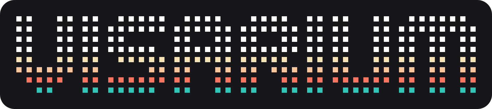
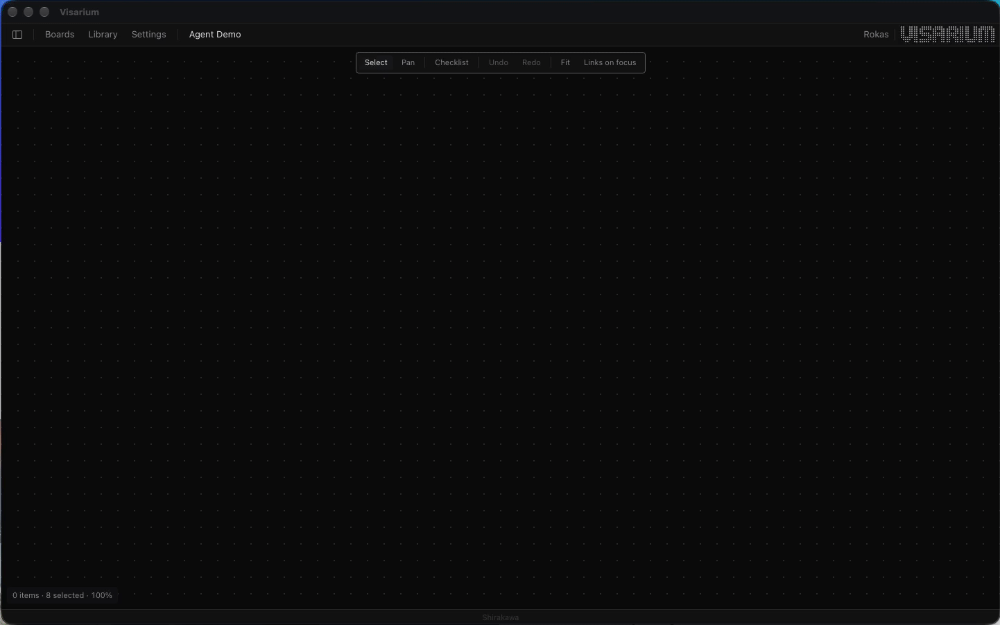

<p align="center">
  
</p>

<p align="center">
  <b>An AI-first infinite canvas where you and your agents build common ground.</b><br>
  Use it on its own as a desktop app, or self-host it and work on boards together, live.<br>
  <a href="https://www.visarium.dev">www.visarium.dev</a>
</p>

<p align="center">
  
  
  
  
  
  
</p>

---

## Why

Working with an agent breaks down at **grounding**: the shared understanding of what each side means. You say "the second option" or "that layout", and the agent guesses. It summarises your references back to you, and you can't tell what it actually took in. In chat, that common ground is never written down, so it drifts.

Visarium puts the common ground on a canvas both of you can see and edit. Images, notes, diagrams and checklists sit side by side, with typed links that say how they relate. Every item and diagram element has a stable reference (`d2#Server`, `c1/t3`), so you can point at exactly what you mean and so can the agent. Its edits are credited to it and appear live, and it records decisions and open questions as proposals for you to settle. Nothing is assumed, because everything is on the board.

> _Honestly? I got sick of juggling screenshots at work, and one thing led to another._

## See it

<p align="center">
  
</p>

**An agent at work.** Claude builds a board through the MCP server. It draws a diagram, links notes to individual elements, proposes a decision for you to settle, and works through a checklist, all appearing live.

<p align="center">
  
</p>

**Typed links, live GIFs.** Connect notes, images, diagrams and checklists with links that say what they mean. Animated images keep playing on the canvas.

More demos at [www.visarium.dev](https://www.visarium.dev).

## Use it your way

- **Local**: a desktop app for macOS, Windows and Linux. Your boards stay on your machine.
- **Hosted**: self-host the server and share boards with people and agents, with everyone's changes showing live.

## Features

- **Infinite canvas**: the board has no edges.
- **Drag in, drag out**: bring in files from a folder or a browser, one at a time or in batches, and drag images back out.
- **Edit in place**: resize, rotate and crop images on the board. Animated GIFs keep playing.
- **Notes, diagrams, checklists**: Markdown notes keep formatting when you paste, and diagrams are written in Mermaid or PlantUML.
- **Typed links**: links between items say what they mean (`describes`, `implements`, `depends-on` and so on), not just "connected".
- **Agents as first-class collaborators**: connect Claude, ChatGPT, Cursor or any other MCP client to a self-hosted server using only its address. Approve access once and revoke it any time.
- **Built-in vision**: point the server at any OpenAI-compatible vision model and every image gets a description that agents and search can use.
- **Your auth**: sign in with an OpenID Connect provider, or switch on password sign-in.

## Quick start

Requires Node ≥ 26, stable Rust, pnpm and [just](https://just.systems).

```sh
pnpm install
just dev        # server on :8080 + web on :5173
just desktop    # desktop app
just test       # Rust + TypeScript tests
just            # all recipes
```

<details>
<summary><b>Self-host the server</b> (Docker, amd64 and arm64)</summary>

<br>

One container serves the web app, the API, live updates and the MCP endpoint. Your data lives in directories on the host.

1. **Get the compose file and settings.**

   ```sh
   git clone https://github.com/rokasklive/visarium.git && cd visarium
   cp .env.example .env
   ```

2. **Choose how people sign in.** The server refuses to start without at least one way in. In `.env`, either add an OpenID Connect provider (recommended), or set `VISARIUM_AUTH_PASSWORD=on` for a first run. Set `VISARIUM_PUBLIC_URL` to the address people will use: sign-in providers, share links and MCP apps all need it.

3. **Pick the image.** To run a release, open `compose.yml`, set `image: ghcr.io/rokasklive/visarium:0.1` and delete the `build:` block. Tags are `X.Y.Z`, `X.Y` and `latest`, and `edge` follows `master`. Leave it as it is to build from source.

4. **Start it.**

   ```sh
   docker compose up -d
   ```

5. **Claim it straight away.** Open <http://localhost:8080> and create the admin account: on a fresh instance, the first person to open it gets admin. Only then point your reverse proxy at it. The app listens on loopback only and ships no TLS, so the proxy provides it. If the proxy runs in another container, the top of `compose.yml` shows how to join its network.

**Your data.** `DATABASE_HOST_PATH` holds the SQLite database: keep it on a local disk, never a network mount. `ASSETS_HOST_PATH` holds the original files, and a NAS mount is fine for it. Back both up. `DERIVATIVES_HOST_PATH` is a cache that can be rebuilt.

**Connect agents.** Point any MCP client at `https://<your-host>/mcp`. You sign in and approve the app in your browser, and you can revoke it under Settings → Agents.

**Upgrade.** Change the image tag, then run `docker compose pull && docker compose up -d`.

</details>

> [!NOTE]
> The Linux desktop app works, but it has had less testing than the macOS and Windows builds. Dropped files land at the centre of the window, and pasting a copied file does not work yet.

## License

[AGPL-3.0-only](LICENSE) © 2026 Rokas Kučinskas. If you run a modified version as a network service, you must offer its source to the people who use it. Contributions are accepted under the same license.
