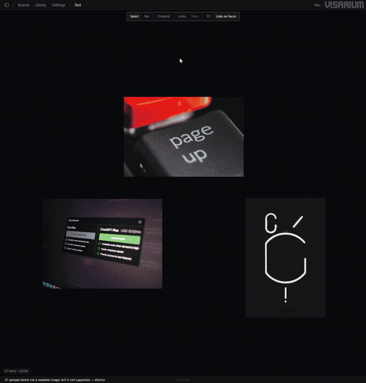
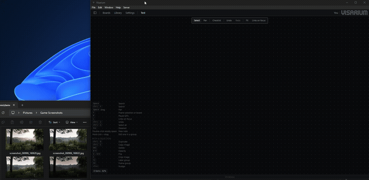
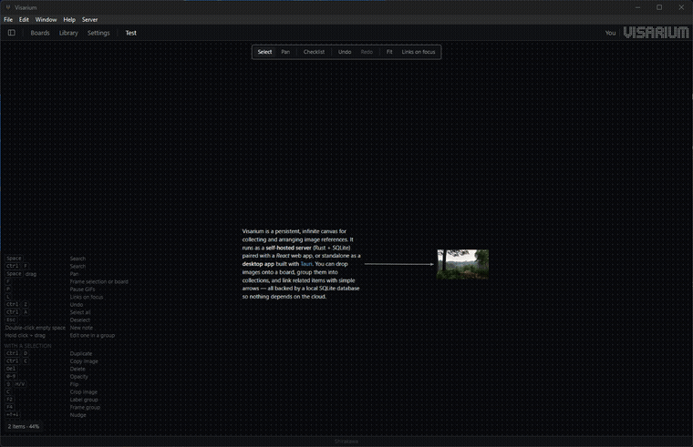
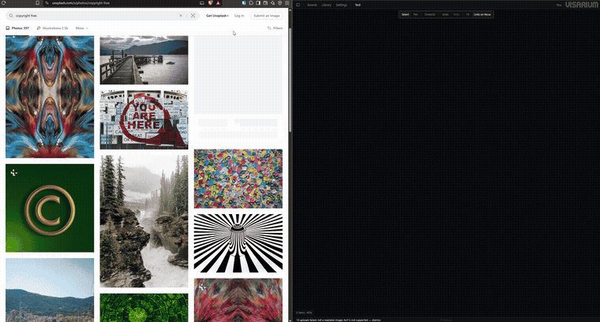
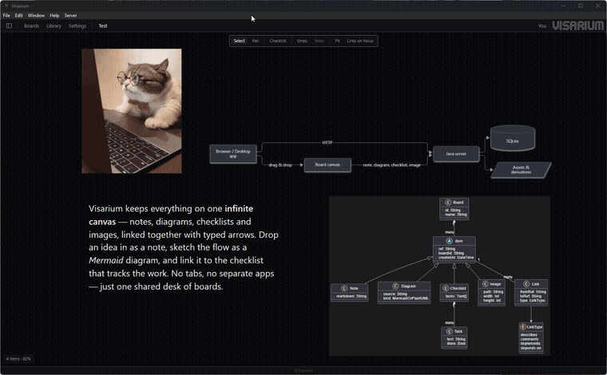
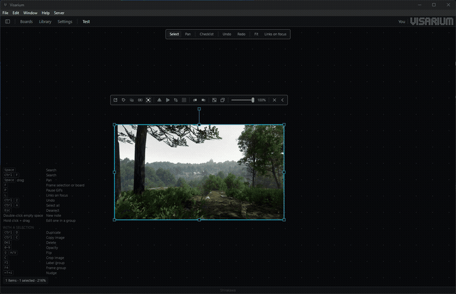
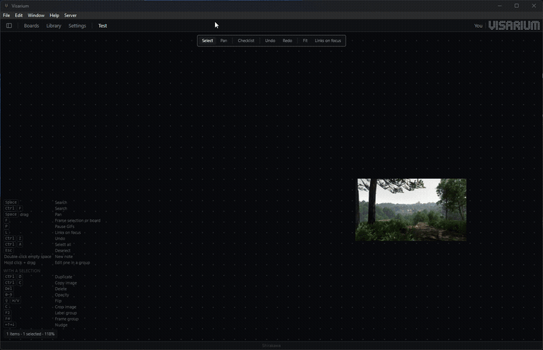

<p align="center">
  
</p>

<p align="center">
  A persistent, infinite canvas for collecting and arranging image references —
  on your desktop on its own, or self-hosted with other people on it.
</p>

<p align="center">
  
  
  
  
</p>

---

## What it is

Visarium is a board for the images you're collecting — moodboards, reference
sheets, research, screenshots — that scrolls and zooms forever instead of
running out of room. Drop pictures onto it, annotate them with notes,
diagrams and checklists, link related things together, and zoom out to see
how it all fits.

Run it as a local desktop app, or self-host the server and work on the same
boards with other people, live.

## Standout features

- **An infinite canvas.** Zoom out and the board keeps going — more pictures,
  more context, no edge to hit.

  

- **Drag in, drag out.** Pull files straight from a folder onto the board,
  one at a time or a whole batch at once, and drag any image back out to your
  desktop just as easily.

  
  

- **Clip straight from the browser.** Keep a site open beside the board and
  drag images from it directly onto your canvas.

  

- **Typed links between items, and GIFs that actually play.** Connect notes,
  images, diagrams and checklists with relationships that say what they
  mean, not just a line — and animated images stay live right on the canvas.

  

- **Resize, rotate, crop — in place.** Reframe an image reference right on
  the board, no round-trip to an editor.

  

- **Rich Markdown notes.** Paste formatted text and it keeps its shape.

  

- **Agents on your boards.** Connect Claude, ChatGPT, Cursor and other MCP
  apps to a self-hosted server by its address alone — sign in and approve
  once, revoke any time from Settings.
- **Vision, built in.** Point a self-hosted server at any OpenAI-compatible
  vision model and every image gets a description, so agents that can't see
  pictures — and search — still know what's in them.
- **Your call on auth.** Sign in with an OpenID Connect provider, or turn on
  password sign-in explicitly. Self-hosted means your boards, your rules.

## Running it

Needs Node ≥ 24, stable Rust, pnpm and [just](https://just.systems).

```sh
pnpm install
just dev        # Rust server on :8080 + Vite on :5173
just desktop    # the desktop app
just test       # Rust and TypeScript tests
just            # everything else
```

Self-hosted: `docker compose up -d` (settings in `.env.example`).

> **Linux:** the desktop app works, but it has had far less polish and testing
> than on macOS and Windows. Expect rough edges, for example dropped files land
> at the window centre and pasting a copied file does not work yet.

## Licence

Copyright © 2026 Rokas Kučinskas.

Visarium is free software under the [GNU Affero General Public License v3.0 only](LICENSE)
(`AGPL-3.0-only`). If you run a modified version as a network service, you must offer its
source to the people who use it.

Contributions are accepted under the same licence.
